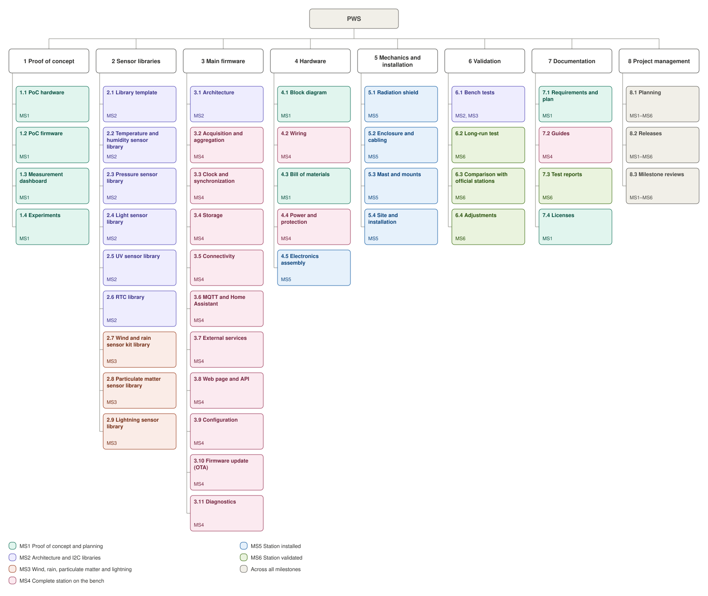

# PWS project plan

This plan breaks the PWS project down into deliverables and work packages (work breakdown structure, WBS) and groups them into technical milestones. Requirement IDs refer to [requirements.md](requirements.md).

## How to read this document

- **Level 1:** the project (PWS).
- **Level 2:** the **deliverables**, the major things the project produces.
- **Level 3:** the **work packages**, pieces of work with a clear start, a clear end and a verifiable result.

Two rules apply:

1. **100% rule:** the WBS contains all the work of the project, and only that work.
2. **Deliverables, not tasks:** each item is a noun ("MQTT and Home Assistant"), not an action ("write the MQTT client"). Tasks are tracked separately.

The WBS says **what** will be done. The **milestones** say **when** a set of deliverables is complete.

---

## 1. Overview (levels 1 and 2)

```
PWS
├── 1 Proof of concept
├── 2 Sensor libraries
├── 3 Main firmware
├── 4 Hardware
├── 5 Mechanics and installation
├── 6 Validation
├── 7 Documentation
└── 8 Project management
```

The full WBS, with each work package colored by milestone:



The editable source of this diagram is [plan-wbs.drawio](plan-wbs.drawio) (open it with [diagrams.net](https://app.diagrams.net/)).

---

## 2. Work packages (level 3)

### 1 Proof of concept

The proof of concept deliberately does not follow the requirements: it exists to learn fast. It is kept simple and does not use the sensor libraries.

| Code | Work package | Result | Requirements |
|---|---|---|---|
| 1.1 | PoC hardware | Board and I2C sensor modules wired on one bus, with an address scan | — |
| 1.2 | PoC firmware | Readings from SHT45, BMP390, VEML7700 and LTR390, with sensor selection via `menuconfig` | — |
| 1.3 | Measurement dashboard | Serial terminal dashboard using ANSI escape codes, updating in place | — |
| 1.4 | Experiments | Photos, logs and notes from quick tests; proof of concept release tag | — |

### 2 Sensor libraries

Each library has a portable C99 core, an ESP-IDF port, packaging as an ESP-IDF component and a bench test report. One work package per library keeps all packages at a similar size.

| Code | Work package | Result | Requirements |
|---|---|---|---|
| 2.1 | Library template | Template repository, defined from the first library developed | NFR-MNT-02, NFR-MNT-03 |
| 2.2 | Temperature and humidity sensor library | SHT4x | FR-MEA-01, 02 |
| 2.3 | Pressure sensor library | BMP390 | FR-MEA-03 |
| 2.4 | Light sensor library | VEML7700 | FR-MEA-07 |
| 2.5 | UV sensor library | LTR390 | FR-MEA-08 |
| 2.6 | RTC library | DS3231 | FR-TIM-01 |
| 2.7 | Wind and rain sensors library | A single library with three modules: anemometer, wind vane and rain gauge | FR-MEA-04 to 06, FR-SMP-11 |
| 2.8 | Particulate matter sensor library | SPS30 or PMS5003 (to be decided) | FR-MEA-09, FR-SMP-10 |
| 2.9 | Lightning sensor library | AS3935 | FR-MEA-10, FR-MEA-11 |

### 3 Main firmware

| Code | Work package | Result | Requirements |
|---|---|---|---|
| 3.1 | Architecture | Layers, tasks, queues and the single record format | NFR-MNT-01, FR-LOG-02 |
| 3.2 | Acquisition and aggregation | Sampling, means, minimums, maximums, gust, vector wind direction, derived quantities | FR-SMP, FR-CAL |
| 3.3 | Clock and synchronization | RTC, NTP, interval alignment, unreliable time flag | FR-TIM |
| 3.4 | Storage | SD card records (CSV and JSON Lines), circular logging, pending uploads | FR-LOG, NFR-REL-03 |
| 3.5 | Connectivity | Wi-Fi, reconnection, configuration access point, mDNS | FR-NET, NFR-USE-05 |
| 3.6 | MQTT and Home Assistant | Publishing, LWT, discovery, late data resending | FR-MQT, NFR-REL-05 |
| 3.7 | External services | Uploads to Weather Underground and Windy | FR-EXT |
| 3.8 | Web page and API | Pages in LittleFS, charts, JSON API, Portuguese and English | FR-WEB, NFR-USE, NFR-PRF-02, 03, 05 |
| 3.9 | Configuration | Settings in NVS, configuration view, factory reset, export and import | FR-CFG |
| 3.10 | Firmware update (OTA) | OTA from the web page, automatic rollback | FR-OTA, NFR-RES-01 |
| 3.11 | Diagnostics | Sensor status, system information, serial log, status LED, automatic restart | FR-DIA, NFR-REL-04, 06 |

### 4 Hardware

| Code | Work package | Result | Requirements |
|---|---|---|---|
| 4.1 | Block diagram | One-page view of the whole station | — |
| 4.2 | Wiring | Wiring diagram for all modules (pins, buses, pull-ups) | CON-03 |
| 4.3 | Bill of materials | Items, quantities and substitutes, without suppliers | NFR-DOC-01 |
| 4.4 | Power and protection | Power supply, power distribution, surge protection, consumption measurement | NFR-PWR, NFR-ENV-05 |
| 4.5 | Electronics assembly | Electronics assembled and mounted in the enclosure | NFR-ENV-02, 04 |

### 5 Mechanics and installation

| Code | Work package | Result | Requirements |
|---|---|---|---|
| 5.1 | Radiation shield | Ventilated shield for temperature and humidity | NFR-ACC-02, CON-07 |
| 5.2 | Enclosure and cabling | IP65 enclosure with cable glands and external cable routing | NFR-ENV-02, 04 |
| 5.3 | Mast and mounts | Mast, wind and rain sensors mount, grounding | NFR-ACC-04, NFR-ENV-05 |
| 5.4 | Site and installation | Site selection, installation and wind vane alignment to north | NFR-ENV-01, FR-CFG-07 |

### 6 Validation

| Code | Work package | Result | Requirements |
|---|---|---|---|
| 6.1 | Bench tests | Simplified test report per module | NFR-DOC-02 |
| 6.2 | Long-run test | 30 days of continuous operation, including induced power and network outages | NFR-REL-01, 02, 05 |
| 6.3 | Comparison with official stations | Trends and mean differences against INMET, CEPAGRI and the SBKP METAR | NFR-ACC-03 |
| 6.4 | Adjustments | Corrections (offsets) applied and documented | FR-CFG-08 |

### 7 Documentation

| Code | Work package | Result | Requirements |
|---|---|---|---|
| 7.1 | Requirements and plan | `requirements.md` and `plan.md` | — |
| 7.2 | Guides | Project README and guides for assembly, flashing and configuration | NFR-MNT-04 |
| 7.3 | Test reports | `docs/tests/` folder with the reports from package 6.1 | NFR-DOC-02 |
| 7.4 | Licenses | Firmware, hardware and mechanical licenses | NFR-DOC-04 |

### 8 Project management

| Code | Work package | Result | Requirements |
|---|---|---|---|
| 8.1 | Planning | Milestone plan, detailed one milestone at a time | — |
| 8.2 | Releases | Branches, tags and release notes for each milestone | — |
| 8.3 | Milestone reviews | Short review at the end of each milestone | — |

---

## 3. Milestones

The **completion criterion** is the observable condition that tells a milestone has been reached.

At the end of each milestone, `dev` is merged into `main` and tagged with the release shown below.

| Milestone | Name | Deliverables (WBS packages) | Completion criterion | Release |
|---|---|---|---|---|
| MS1 | Proof of concept and planning | 1.1 to 1.4; 4.1, 4.3; 7.1, 7.4 | Proof of concept runs and is tagged; requirements, plan, block diagram and bill of materials published | `v0.1.0` |
| MS2 | Architecture and I2C libraries | 2.1 to 2.6; 3.1; 6.1 (I2C sensors and RTC) | Library template ready; I2C and RTC libraries published and tested; architecture documented | `v0.2.0` |
| MS3 | Wind, rain, particulate matter and lightning | 2.7 to 2.9; 6.1 (these sensors) | Libraries published and bench tested | `v0.3.0` |
| MS4 | Complete station on the bench | 3.2 to 3.11; 4.2, 4.4; 7.2 | Complete firmware running on the bench with all sensors, meeting the requirements that can be verified on the bench | `v0.4.0` |
| MS5 | Station installed | 4.5; 5.1 to 5.4 | Station assembled and running at its final site | `v0.5.0` |
| MS6 | Station validated | 6.2 to 6.4; 7.3 | Long-run test completed and comparison with official stations documented | `v1.0.0` |

Package 8 (project management) runs across all milestones.

---

## 4. Requirements coverage

Every requirement group is covered by at least one work package:

| Requirements | Work packages |
|---|---|
| FR-MEA | 2.2 to 2.5, 2.7 to 2.9 |
| FR-CAL, FR-SMP | 3.2 |
| FR-TIM | 2.6, 3.3 |
| FR-LOG | 3.4 |
| FR-NET | 3.5 |
| FR-MQT | 3.6 |
| FR-EXT | 3.7 |
| FR-WEB | 3.8 |
| FR-CFG | 3.9, 5.4, 6.4 |
| FR-OTA | 3.10 |
| FR-DIA | 3.11 |
| NFR-ACC | 5.1, 5.3, 6.3 |
| NFR-PRF | 2.7 (pulse counting, NFR-PRF-04), 3.6 (NFR-PRF-01), 3.8 |
| NFR-REL | 3.4, 3.6, 3.11, 6.2 |
| NFR-ENV | 4.4, 4.5, 5.2, 5.3, 5.4 |
| NFR-PWR | 4.4 |
| NFR-USE | 3.5, 3.8 |
| NFR-RES | 3.10 (partitions), 4.3 (SD card, NFR-RES-02) |
| NFR-MNT | 2.1, 3.1, 7.2 |
| NFR-DOC | 4.3, 6.1, 7.3, 7.4 |
| CON | 3.1 (platform choices), 4.2, 5.1 |
