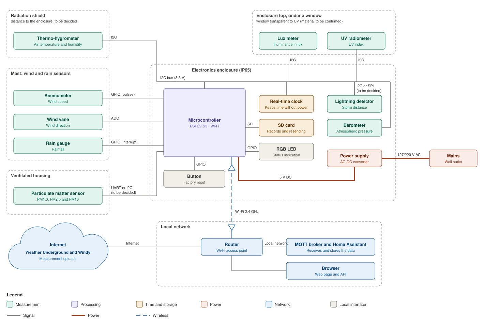

# Hardware

## Block diagram

The editable source is [block-diagram.drawio](block-diagram.drawio) (open it with [diagrams.net](https://app.diagrams.net/)).

This is a functional block diagram: each block shows a function, not a specific part. The parts, with their substitutes, are listed in the [bill of materials](bom.md). The only part named in the diagram is the ESP32-S3, because it is a project constraint (CON-01). The interface of each connection is written on the line.

Blocks are grouped by where they are installed:

- **Radiation shield:** thermo-hygrometer (air temperature and humidity).
- **Mast:** wind and rain sensors. The anemometer delivers pulses, the wind vane is read by the ADC, and the rain gauge delivers one pulse per tip, read by interrupt.
- **Ventilated housing:** particulate matter sensor.
- **Enclosure top, under a window:** lux meter and UV radiometer, which need a view of the sky.
- **Electronics enclosure (IP65):** microcontroller, real-time clock, barometer, lightning detector, SD card, factory reset button, RGB status LED and power supply.
- **Local network:** router, MQTT broker and Home Assistant, browsers (web page and API).
- **Internet:** Weather Underground and Windy. The station works without internet access; only these uploads depend on it.

All I2C devices share one I2C bus at 3.3 V.

## Open points

| Topic | Status |
|---|---|
| Distance between the radiation shield and the enclosure | To be decided with the mechanical design. I2C is not meant for long cables; a long distance requires an I2C bus extender. |
| Particulate matter sensor interface | UART or I2C, to be decided with the sensor choice. |
| Lightning detector interface | I2C or SPI, to be decided. |
| Window material for the light and UV sensors | To be confirmed: the window must let UV through. |
